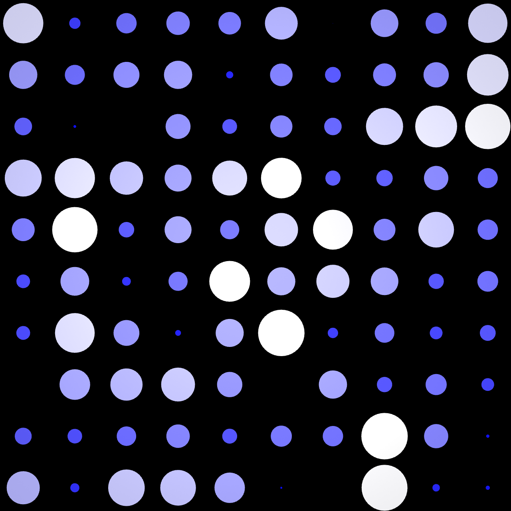
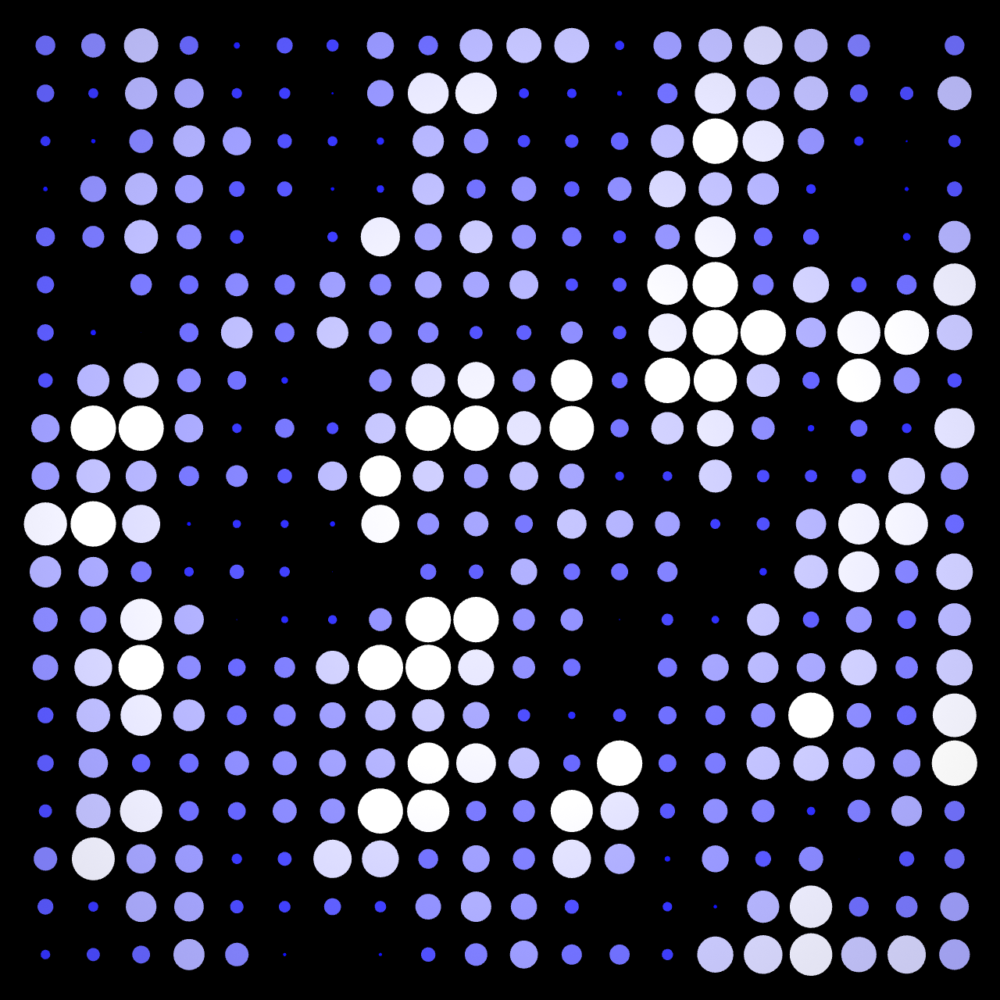
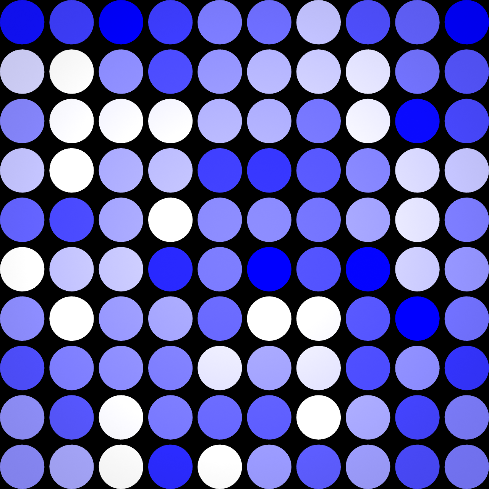

# AMG_MCP 제작 기능·예제 프롬프트 검증 — 2026-10-11

## 2026-10-12 최신 TD 2025.33230

현재 수업 기준과 예제는 **2025.33230 Official**입니다. 최신 버전에서 예제3종과 저장 TOE 새 실행을 검사했습니다. [최신 실제 검증](TD_LATEST_VERIFICATION.md). 아래32820 기록은 이전 제작 이력입니다.

**학생 배포본의 기존 AMG_MCP 1.0 / protocol 2 / 포트 9987로 실제 제작·검증을 통과했다.**
TD 2025.32820 / Windows / Python 3.13.16 / MCP 2.3.0 환경이다. 새 앱 개발판을 사용하지 않았다.

## 사용 순서

배포 TOE 열기 → [연결](../prompts/01-connect.txt) → [10×10 제작](../prompts/02-build.txt) → [검증](../prompts/03-check.txt) → [20×20 확장](../prompts/04-build-20x20.txt) 또는 [색만 변화](../prompts/05-build-color-only.txt).

[전체 프롬프트 복사 문서](EXAMPLE_PROMPTS.md)의 각 코드 블록을 통째로 복사한다. 질문 예시가 아니라 실제 제작·검사를 요청하는 완성 요청문이다.

## 실제 화면 검사

| 예제 | CHOP 샘플/채널 | v=1 실제 원 | v=0 실제 원 | v=0.5 / 1 지름비 | TOX 재로드 차이 픽셀 |
|---|---:|---:|---:|---:|---:|
| W05_PROMPT_PRACTICE | 100 | 100 | 0 | 0.504 | 0 |
| W05_EXAMPLE_20X20 | 400 | 400 | 0 | 0.508 | 0 |
| W05_EXAMPLE_COLOR_ONLY | 100 | 100 | 100 | 1.000 | 0 |

기본 예제에서 v=0이면 원이 사라지고 v=0.5에서 반지름이 절반, 파랑 성분이 더 크다. v=1에서 중심 RGB=(254,254,254)로 흰색이다. 중간값의 약 0.5 지름비는 픽셀 경계·안티앨리어싱을 포함한 실제 측정이다. 최대 2.5% 오차를 허용했고 100개/400개에서 통과했다.

왼쪽 위 한 픽셀만 흰색인 시험 입력에서 실제 같은 위치의 원 하나만 확인했다. 기본 예제와 기존 container2의 Noise Z=2.4 출력도 픽셀 차이 0이다. 20×20의 v=1 원 400개는 서로 분리됐고 화면 경계 안에 들어왔다.

세 예제마다 약 1초 간격 3장을 검사해 색 픽셀의 변화가 있음을 확인했다. 기본/400개 예제는 원 영역도 바뀌고, 색만 변화하는 예제의 원 영역 차이는 0이었다. 모든 최종 네트워크는 오류 0·경고 0이다.

### TOP 실제 캡처

## 확인한 MCP 기능과 제한

도구 목록은 55개다. 이 검사에서 실제 사용한 도구는 20개이며 55개 전체 기능을 검사한 것은 아니다. 세션·상태·실제 파라미터/메뉴·생성·복사·설정·연결·위치 정리·CHOP 조회·TOP 미리보기/저장·오류 검사·TOX 저장/재로드·삭제를 확인했다. [수치 결과](../verification/results.json)에 사용 도구 목록과 검사 범위를 기록한다.

- 현재 Codex에 등록된 9981 연결은 `unknown_action: get_capabilities`로 세션 시작에 실패했다. **설치가 생성한 9987 설정으로 AI의 MCP를 등록/재연결해야 한다.** 9987의 표준 MCP stdio 연결을 통해 위 제작을 수행했다.
- `td_list_operator_symbols`는 TD 전체 노드 목록이며 생성 허용 목록이 아니다. 실제 `capabilities.operator_types`를 사용해야 한다. CHOP to DAT 생성을 두 표기법으로 요청했으나 현재 Bridge에서 거절됐다. 임의 코드로 우회하지 않았다.
- CHOP 조회 도구는 전체 배열 대신 샘플 수와 첫 값을 반환한다. 전체 위치 검사는 **각 예제 내부**의 임시 Math(+0.5) → CHOP to TOP RGB → PNG 분기로 수행했다. 음수 좌표를 0~1로 이동해 100/400개 고유 XY, 10/20개 X/Y, Z≈0을 확인했다. PNG 8비트 정밀도이며 정확한 원시 float 배열을 읽은 검사는 아니다. 다른 Container에서 가져온 CHOP를 보조 노드에 직접 연결하니 검사 이미지가 비어, 해당 예제 안에서 분기를 만들어 다시 확인했다. 최종 검사 후 임시 노드는 제거했다.
- 기본 예제는 8개 노드를 새로 만들고 Geometry SOP 커넥터 구조와 Noise 시간식은 기준 예제에서 복사했다. 확장 예제는 검증한 새 Container를 복사해 규칙을 바꿨다. 임의의 빈 프로젝트에서 모든 구조를 처음부터 생성했다고 주장하지 않는다.
- 기본 Scale은 v이며 0.4 최소 크기 보정·Math/Clamp/Shuffle를 작품 흐름에 추가하지 않았다. 위치 분석용 임시 Math는 검사 후 제거했다.
- AI가 요청문을 MCP 호출로 분해하고 실행한 결과다. 다른 AI/새 세션의 텍스트만으로 항상 같은 첫 시도 결과가 나온다는 반복 재현 시험은 아니다. 미확인 항목은 미검증으로 보고하도록 요청문에 적었다.
- Mac 창 자동화는 사용하지 않았다. Mac 실기와 GitHub Actions 원격 실행은 아직 미검증이다.

## 완성 예제와 보존 범위

- [기본 10×10 TOX](../touchdesigner/W05_AMG_10x10_verified.tox)
- [20×20 TOX](../touchdesigner/W05_EXAMPLE_20X20_verified.tox)
- [색만 변화 TOX](../touchdesigner/W05_EXAMPLE_COLOR_ONLY_verified.tox)

TOX는 연결된 수업 TOE의 작업 Root에 추가해서 확인한다. 실습 프롬프트로 다시 만들 때는 기존 완성 예제와 이름이 겹치면 별도 이름을 사용한다. 위 TOX의 고정값 출력 재로드는 실제 검사했고, 완전히 새 TD 프로세스에서 독립 실행한 검사는 별도다.

열린 원본 프로젝트에는 새 실습 Container 3개를 만들었다. 기존 4주차 예제·Bridge·TOE 파일을 덮어쓰지 않았고 시험 복제본과 임시 분기는 정리했다. 현재 열린 프로젝트에서 이름으로 확인할 수 있다. 기존 PPT/PDF, 배포 wheel/Bridge/기준 TOE는 유지했다.

## 2026-10-12 새 TD 시작 연결 수정

최신 학생 배포는 **1.0.1**이다. 저장된 콜백 이름의 대소문자 참조를 수정하고 새 TD 프로세스·9987 MCP 시작·렌더·Bridge 재로드를 통과했다. [수정 및 실제 검증 범위](CONNECTION_VERIFICATION_1.0.1.md). 이전 9981 실패 기록은 당시 상태이며 현재 저장 설정은 9987이다. 실행 중이던 AI 연결에는 재시작이 필요하다. Mac 실기 미검증은 유지한다.
